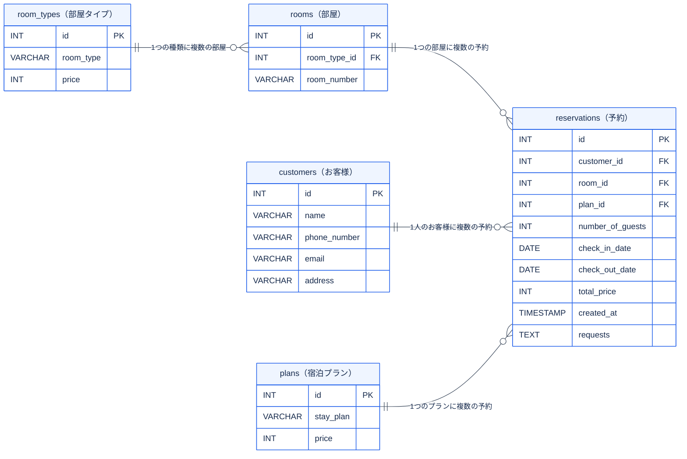

# データベース設計

## ER図

**ER図の見方**：`PK` は主キー、`FK` は外部キーです。線の `||` は「1件」、`o{` は「0件以上」を表します。たとえば「1人のお客様に予約が複数件」という関係です。

## customersテーブル

| 列名 | 日本語名 | データ型 | 必須 | 備考 |
|---|---|---|---|---|
| id | ID | INT | ○ | 主キー、自動で番号をふる |
| name | 名前 | VARCHAR | ○ | |
| phone_number | 電話番号 | VARCHAR | ○ | |
| email | メールアドレス | VARCHAR | ○ | |
| address | 住所 | VARCHAR | ○ | |

## reservationsテーブル

| 列名 | 日本語名 | データ型 | 必須 | 備考 |
|---|---|---|---|---|
| id | ID | INT | ○ | 主キー、自動で番号をふる |
| customer_id | customersテーブルの主キー | INT | ○ | 外部キー、統合時にお客様情報も同時に閲覧できるため |
| room_id | roomsテーブルの主キー | INT | ○ | 外部キー、部屋情報、金額の情報を引き継げる。 |
| plan_id | plansテーブルの主キー | INT | ○ | 外部キー、宿泊プラン、その選択による金額の情報まで引き継げる。 |
| number_of_guests | 宿泊人数 | INT | ○ | |
| check_in_date | チェックイン日 | DATE | ○ | |
| check_out_date | チェックアウト日 | DATE | ○ | |
| total_price | 合計金額 | INT | ○ | 予約確定時に計算した合計金額を保存 |
| created_at | 入力日時 | TIMESTAMP | | フォーム送信時自動で設定される |
| requests | ご要望 | TEXT | | |

## roomsテーブル

| 列名 | 日本語名 | データ型 | 必須 | 備考 |
|---|---|---|---|---|
| id | ID | INT | ○ | 主キー、自動で番号をふる |
| room_type_id | room_typeの主キー | INT | ○ | 外部キー、部屋の種類を紐づけることで、部屋が決められるのと金額が紐づく。 |
| room_number | 部屋番号 | VARCHAR | ○ | 3ランクある部屋がそれぞれ3部屋ずつ、あとから自動で振り分け |

## plansテーブル

| 列名 | 日本語名 | データ型 | 必須 | 備考 |
|---|---|---|---|---|
| id | ID | INT | ○ | 主キー、自動で番号をふる |
| stay_plan | 宿泊プラン | VARCHAR | ○ | |
| price | 金額 | INT | ○ | 宿泊プランによって変動 |

## room_typesテーブル

| 列名 | 日本語名 | データ型 | 必須 | 備考 |
|---|---|---|---|---|
| id | ID | INT | ○ | 主キー |
| room_type | 部屋の種類 | VARCHAR | ○ | |
| price | 金額 | INT | | |
